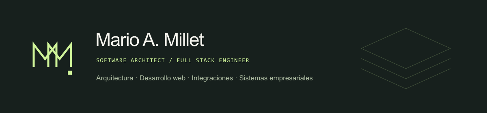

# Mario A. Millet

### Arquitecto de software · Desarrollador Full Stack

Diseño y construyo software desde el proceso de negocio hasta la implementación: aplicaciones web, servicios, integraciones, datos y despliegue. Mi trabajo combina decisiones de arquitectura con desarrollo práctico; Odoo es mi especialidad más sólida dentro de una experiencia técnica más amplia.

**+3 años de experiencia** · Equipos de Latinoamérica y Europa · Santiago de Cuba · Colaboración remota

[Portafolio ES / EN](https://mariomillet2b.github.io/) · [CV Full Stack](https://mariomillet2b.github.io/cv/full-stack/Mario_Millet_CV_Full_Stack.pdf) · [CV Odoo](https://mariomillet2b.github.io/cv/odoo/Mario_Millet_CV_Odoo.pdf) · [Contacto](mailto:mariomillet2b@gmail.com)

## Del contexto a la solución

- **Arquitectura y sistemas:** análisis funcional, estructura de módulos y decisiones de despliegue en producción.
- **Desarrollo full stack:** interfaces web, servicios backend, APIs y bases de datos.
- **Integración y automatización:** servicios conectados, webhooks, WhatsApp Business e IA aplicada a procesos.
- **Software empresarial:** desarrollo Odoo a medida, modernización y migraciones de aplicaciones y datos.

<!-- GENERATED FULL STACK PROJECTS -->
## Proyectos full stack

**[Hipersitio](https://hipersitio.com/)** · Ecosistema SaaS y presencia web 
Desarrollo del ecosistema web, con aplicaciones Next.js y una plataforma de catálogos multi-tenant. Despliegue y configuración de CI/CD, DNS y certificados SSL. 
Next.js · React · TypeScript · PostgreSQL · Prisma

**italian-store** · eCommerce de cashmere · Marca prevista: Floro Milano 
Tienda de ropa de cashmere con Laravel y React/TypeScript; panel de administración Filament y pagos con Stripe Checkout. 
Laravel · React / TypeScript · Inertia · Filament · Stripe

<!-- END GENERATED FULL STACK PROJECTS -->

## Experiencia que respalda el trabajo

**DESOFT · Arquitecto de Software / Desarrollador Odoo · Abr 2023–actualidad**  
Arquitectura y desarrollo de una plataforma integral de gestión empresarial. Liderazgo de migraciones Odoo 9 → 15 → 17 → 19 y migración de la base de datos a AlloyDB en Google Cloud.

**GoodComex SAS · Desarrollador Odoo · Ago 2024–ene 2026**  
Módulos a medida, migraciones, análisis funcional e integraciones en un equipo Odoo Ready Partner para clientes de distintos sectores.

**Jumo Technology · Desarrollador Odoo y Web · Mar–ago 2024**  
Desarrollo en Odoo e implementación de flujos operativos automatizados con IA.

**Dynamica / AteneoLab · Desarrollador Odoo · Jun 2023–mar 2024**  
APIs, integración frontend y funcionalidades llevadas a producción en proyectos remotos para Panamá y Ecuador.

## Tecnologías por contexto

| Contexto | Herramientas |
| --- | --- |
| Web | React · TypeScript · JavaScript · Next.js · Angular · Tailwind CSS · HTML · CSS |
| Backend e integración | Python · Node.js · NestJS · Django REST Framework · PHP · Laravel · REST · Webhooks |
| Sistemas empresariales | Odoo 9, 12, 14–19 · OWL · XML / QWeb · JSON-RPC |
| Datos e infraestructura | PostgreSQL · AlloyDB · Prisma · MySQL · SQL Server · Docker · Linux · Traefik · Git · CI/CD · DNS · SSL |
| IA aplicada | Integración de LLMs · MCP · Chatbots · WhatsApp Business |

## Código abierto

[**mcp-odoo**](https://github.com/MarioMillet2b/mcp-odoo) — contribución a un servidor MCP que conecta asistentes de IA con Odoo mediante consulta, descubrimiento, diagnóstico y flujos de escritura controlados. Se conserva la autoría original del proyecto.

Licenciatura en Ciencias de la Computación · Universidad de Oriente · 2020–2024

**¿Un proyecto o una oportunidad de colaboración?** [Conversemos](mailto:mariomillet2b@gmail.com).
